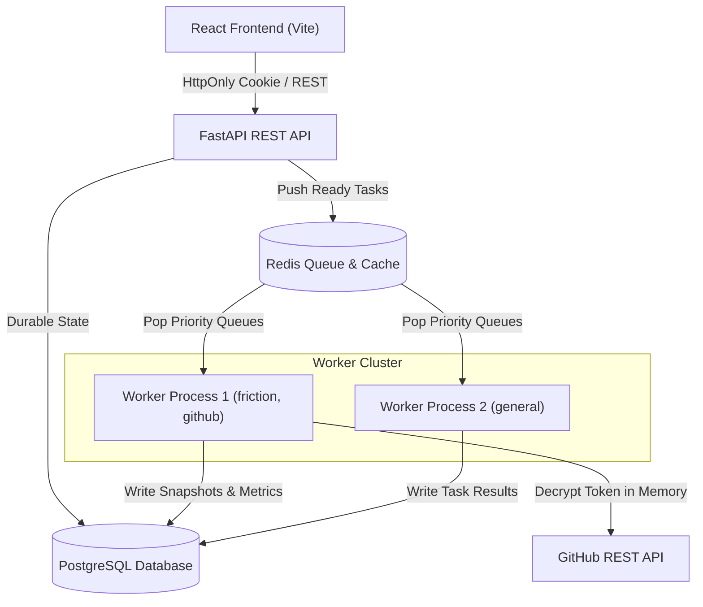
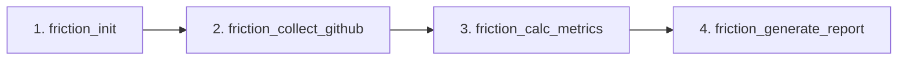

# WorkerGrid + Project Friction Architecture Document

## System Overview

WorkerGrid is a distributed asynchronous task execution platform designed for high throughput, fault tolerance, and multi-tenant isolation. Project Friction operates as an application layer on top of WorkerGrid, leveraging its worker cluster and DAG execution engine to perform GitHub repository analytics.

---

## Component Architecture

### 1. API Layer (`main.py`, `app/api/`)
- **FastAPI Framework**: Exposes REST endpoints for authentication, task control, workflow submission, and Project Friction analytics.
- **Authentication Router (`app/api/auth_router.py`)**: Handles user signup, password login, HttpOnly cookie sessions, and GitHub OAuth 2.0 exchange.
- **Project Friction Router (`app/api/friction_router.py`)**: Manages analysis creation, run status polling, scorecard fetching, and indicator/evidence drill-down.

### 2. Database Layer (`app/models/`, `migrations/`)
- **PostgreSQL**: Serves as the source of truth for persistent entity ownership and workflow state.
- **Core Entities**:
  - `User`: Accounts with email, hashed passwords, and status.
  - `UserGitHubAccount`: Encrypted GitHub OAuth tokens (`encrypted_access_token`), scopes, and identity.
  - `Task`: Task state, priority, retries, capabilities, worker assignment, and parent workflow links.
  - `Repository`: GitHub repository metadata scoped to `(user_id, full_name)`.
  - `FrictionAnalysisRun`: Analysis run state, time window, overall score, and friction level.
  - `FrictionRawSnapshot`, `FrictionMetric`, `FrictionIndicator`, `FrictionEvidence`: Metric calculation records and evidence items scoped by `user_id`.

### 3. Queue & Caching Layer (`app/queue/`)
- **Redis Structures**:
  - `high_priority_queue`, `medium_priority_queue`, `low_priority_queue`: FIFO queues for ready work.
  - `dead_letter_queue`: Task IDs that exhausted retry attempts.
  - `worker_heartbeats`: Hash recording worker online status and last active timestamp.

### 4. Worker Execution Engine (`worker.py`)
- **Independent Execution**: Standalone worker processes run `worker.py` loops polling Redis priority queues.
- **Capability Routing**: Workers compare `task.required_capability` against their declared capabilities (`WORKER_CAPABILITIES="general,friction,github"`).
- **In-Memory Token Decryption**: Workers fetch encrypted tokens from `UserGitHubAccount` in PostgreSQL using `user_id` and decrypt via `decrypt_token()` in memory. Plaintext tokens are never logged or stored in task payloads.

---

## Project Friction 4-Stage Workflow DAG

Project Friction executes repository analyses via a 4-stage DAG workflow definition generated by `build_friction_workflow_definition()`:

1. **`friction_init`**: Initializes database records for `Repository` and `FrictionAnalysisRun`.
2. **`friction_collect_github`**: Fetches pull requests, CI workflow runs, and issue activity over the analysis window using `GitHubClient`.
3. **`friction_calc_metrics`**: Computes PR review latency, stale PR ratios, merge times, CI failure rates, and backlog close times.
4. **`friction_generate_report`**: Calculates dimension scores, overall friction score, severity-classified indicators, evidence links, and recommendations.

---

## Fault Tolerance & Failure Recovery

- **Exponential Backoff Retries**: Tasks failing during worker processing increment `task.retries`. Retries delay execution by $2^{\text{retries}}$ seconds before re-enqueueing.
- **Dead-Letter Queue (DLQ)**: Once `task.retries >= task.max_retries`, task status is marked `FAILED` and task ID is pushed to `dead_letter_queue`.
- **Workflow Failure Propagation**: When a stage fails, `release_dependents()` transitions all downstream waiting tasks to `FAILED` with `last_error="A workflow dependency failed."`.
